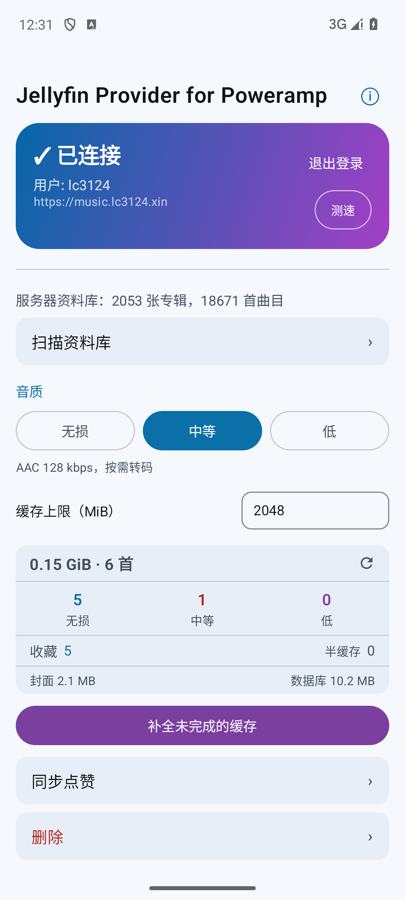
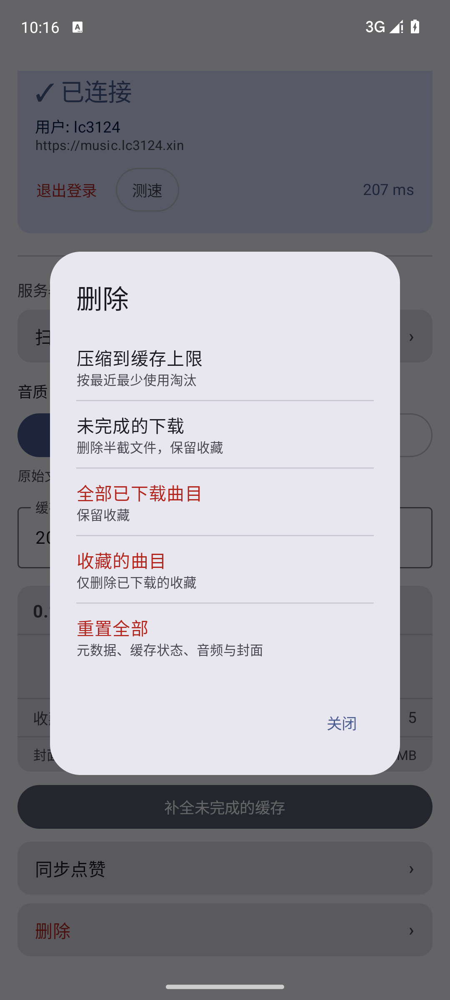
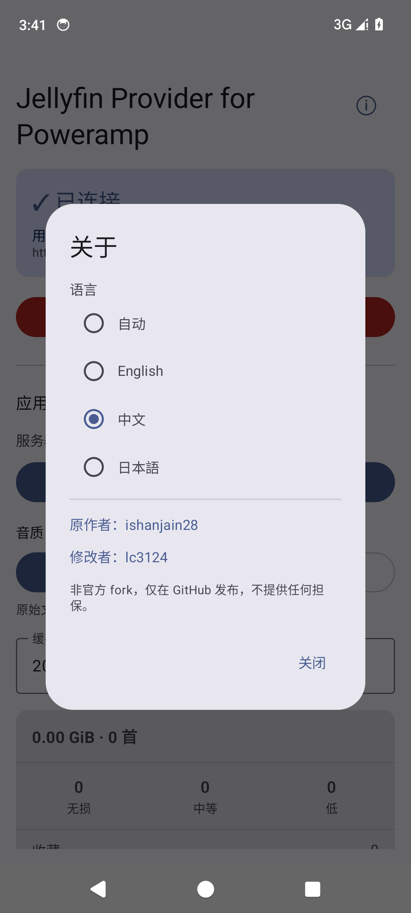
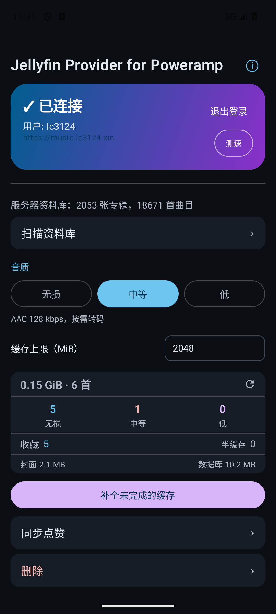
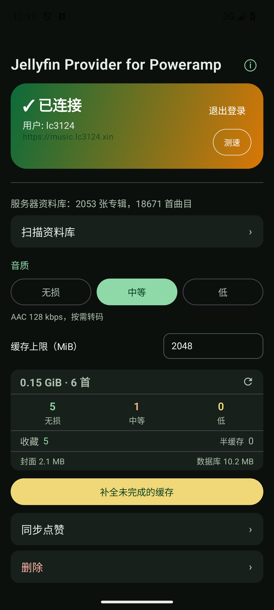
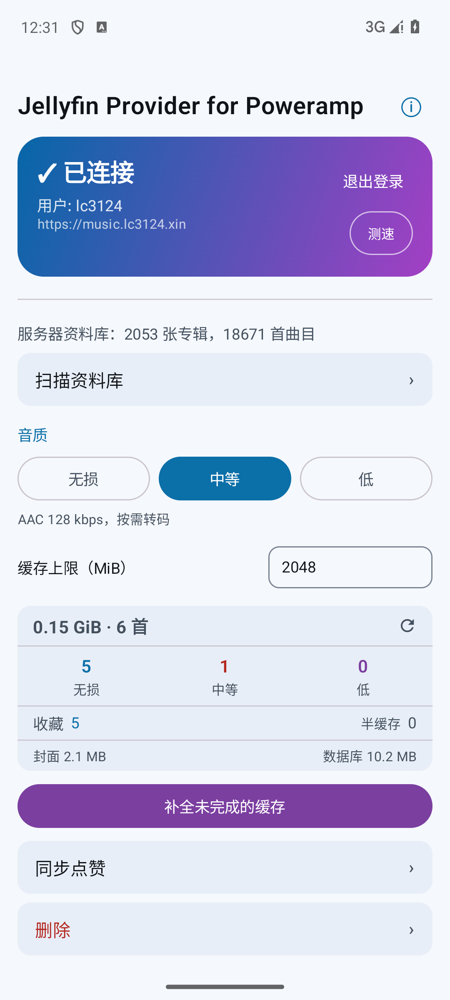
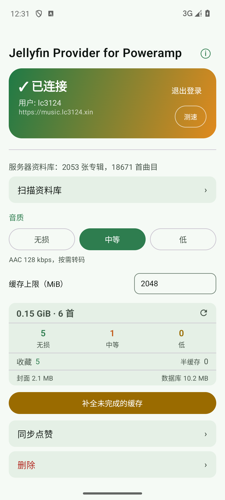

<p align="center"></p>

<h1 align="center">Jellyfin Provider for Poweramp</h1>

<p align="center"><b>English</b> | <a href="README.md">中文</a></p>

Expose your [Jellyfin](https://jellyfin.org) music library over Android's **Storage Access
Framework (SAF)** as folders, so players that only understand local files — mainly
[Poweramp](https://powerampapp.com/) — can browse, stream and cache your server library.

The app publishes three roots:

| Root | Purpose |
| --- | --- |
| **Jellyfin Music** | Browse by album. Streams on demand, caches while playing, seeking works anywhere. |
| **Jellyfin Folders** | Browse the physical folders on the server (label / album artist → album → track). |
| **Jellyfin Cache** | Offline library. Only fully downloaded tracks, with tags, artwork and lyrics, no network needed. |

> Both online roots render from the same database snapshot: identical tracks, tags and artwork,
> only the grouping differs. Adding both to Poweramp will show every song twice — pick one.

## Disclaimer

> This is a personal fork of
> [ishanjain28/jellyfin-saf-provider](https://github.com/ishanjain28/jellyfin-saf-provider).
> **The original author has not reviewed, authorised, or endorsed this fork.** All credit for the
> original design and implementation belongs to them. Upstream ships no licence file, so this fork
> claims no additional rights: it exists strictly for technical study and personal experimentation.
>
> It is **not** published anywhere except this GitHub repository — no Play Store, no mirrors, no
> paid or bundled builds. Please do not redistribute it elsewhere or use it commercially.
>
> APKs are signed with the **default Android debug key**, not with a maintainer release key. They
> are provided as-is, without warranty and without any security review. Check the SHA-256 yourself
> and install at your own risk.

## Screenshots

<table>
  <tr>
    <td align="center"><br/>Connection and audio quality</td>
    <td align="center"><br/>Cache statistics</td>
  </tr>
  <tr>
    <td align="center"><br/>Delete actions in a dialog</td>
    <td align="center"><br/>Language and credits</td>
  </tr>
</table>

## Colour styles

Four fixed palettes, switched from the ⓘ dialog with colour swatches; the choice applies instantly
and is remembered:

<table>
  <tr>
    <td align="center"><br/>Dark · blue / purple / red</td>
    <td align="center"><br/>Dark · green / yellow / orange</td>
  </tr>
  <tr>
    <td align="center"><br/>Light · blue / purple / red</td>
    <td align="center"><br/>Light · green / yellow / orange</td>
  </tr>
</table>

## Features

- **Three SAF roots** — streaming library, folder view and a fully offline cache.
- **Three audio qualities** — lossless / medium (AAC 128k) / low (AAC 64k), for online playback or
  for offline downloads only.
- **Two-way favourite sync** (through Poweramp's content provider). “Sync Likes” opens a dialog:
  - **Pull** writes Jellyfin favourites into Poweramp as `rating = 5`; it only adds, never downloads,
    and rewrites anything Poweramp shows as 0 (so a rebuilt Poweramp library is restored);
  - **Push** previews the change set first (“add X / remove Y”) and only touches Jellyfin after you
    confirm, then downloads the favourites.
  - Scanning the library no longer syncs favourites automatically.
- **Full metadata** — title, artist, album artist, year, track/disc number, genre, favourite flag,
  lyrics (including LRC timings) and artwork are all served through the SAF cursor, also offline.
- **Scanning with an incremental mode** — the first scan fetches albums with four concurrent
  workers and batch-writes them; later scans ask the server only for changed items (usually a
  second) and fall back to a full scan when counts disagree, cleaning up deleted tracks.
- **Cache management** — LRU eviction, completing partial downloads, per-quality statistics; tap the
  cache card to refresh, destructive actions live in a dialog.
- **Connected card** — logout and a speed test (round-trip latency to `/System/Info/Public`, shown
  in a toast) sit on the right side of the card.
- **Cache card** — tap to refresh, a refresh icon in the corner, favourites and partially cached
  tracks side by side.
- **Languages and colours** — follows the system language, switchable to English / 中文 / 日本語 from
  ⓘ, plus four colour palettes chosen with swatches.
- **Credentials** — password and access token are encrypted with an AES/GCM key in Android Keystore.

## How it works

```
Poweramp ── SAF (content://) ──> JellyfinMusicProvider (DocumentsProvider)
                                      │
                    ┌─────────────────┼──────────────────┐
                    ▼                 ▼                  ▼
          JellyfinClientManager  TrackPlaybackManager   Room
          (Jellyfin SDK + OkHttp) (streaming & cache)    (metadata, chunk bitmap, lyrics)
                    │                 │
                    ▼                 ▼
              Jellyfin server   files/jellyfin_tracks/*.cache
```

- **Self-describing document IDs** — `trk;album;track;size;duration` online, `ctrk;…` offline.
  SAF's `getSize()` is a synchronous call, so encoding size and duration into the ID avoids extra
  database or network round-trips.
- **Lossless tier** — one sparse file per track, downloaded in 256 KiB chunks with a bitmap in Room
  recording which chunks are on disk; reads block until the requested chunk arrives, so playback
  starts immediately and seeking works anywhere.
- **Transcode tier** — served through a `ProxyFileDescriptor` while ffmpeg writes the stream;
  the cache file is swapped in atomically when the download completes, and the reported length is
  estimated from bitrate × duration.
- **Complete cache hit** — returns the real file descriptor, with no network and no proxy overhead.

## Install and use

1. Download the APK from [Releases](https://github.com/lc-3124/jellyfin-saf-provider/releases) and
   install it.
2. Open the app, enter the server URL, username and password. After login the library is scanned
   automatically.
3. In Poweramp: *Settings → Libraries → Folders/Libraries → Add folder* and tick **Jellyfin Music**,
   **Jellyfin Folders** or **Jellyfin Cache** — one of them.
4. Play a song; it caches while playing and shows up in the offline library once complete.

## Audio qualities

| Tier | Playback | Cache file |
| --- | --- | --- |
| Lossless | Original file, `static=true` | `<id>.cache` |
| Medium | AAC 128 kbps transcode | `<id>.aac128.cache` |
| Low | AAC 64 kbps transcode | `<id>.aac64.cache` |

- Only one cache file per track is kept, preferring the **higher quality**; switching to a lower
  tier does not delete an existing high-quality cache.
- On play, a cached tier at least as high as the current setting is used directly; otherwise the
  track is trans-coded/downloaded at the current tier.
- Every transcode request carries a unique `playSessionId`, so Jellyfin cannot reuse an old task
  with a stale bitrate.

## Favourite sync

“Sync Likes” opens a dialog; both directions are manual, and **scanning never pulls automatically**.

**Pull (Jellyfin → Poweramp)**

- Reads every remote favourite and writes `rating = 5` wherever Poweramp has 0;
- it writes again even if the track was synced before, so a rebuilt or cleared Poweramp library is
  restored;
- add-only, no downloads, existing 1–5 ratings are left untouched.

**Push (Poweramp → Jellyfin, with confirmation)**

- First computes the difference and shows “add X / remove Y”; if nothing changed it just says the
  two sides already match;
- After confirmation, every track rated 1–5 in Poweramp becomes a Jellyfin favourite;
- Jellyfin favourites that Poweramp knows but did not like are un-favourited;
- Favourites are then downloaded at the current quality.

> Writing to Poweramp uses its **undocumented** content provider
> (`com.maxmpz.audioplayer.data/files`), verified on build 1035. Future versions may change; the app
> validates every write and stops on failure.

## Scanning and incremental sync

“Scan Library” opens a dialog with two entries:

**Full scan**

- Fetches tracks album by album with four concurrent workers (this server saturates around 3–6
  requests/second, so four is enough);
- batch-writes each album instead of one transaction per track; albums with more than 100 tracks are
  paged;
- removes tracks the server no longer has and stores a sync cursor;
- measured at about **83 seconds** for 2,053 albums / 18,670 tracks.
- A handful of server tracks have no album (`albumId=null`) and cannot be reached by an album scan;
  they are covered by `ORPHAN_TOLERANCE` so the count never triggers a full rescan forever.

**Incremental scan**

- Uses Jellyfin's `MinDateLastSaved` to fetch only items changed since the last sync — measured at
  **under a second**;
- the cursor uses server-local time with a 30-minute overlap, and repeated writes are idempotent;
- increments cannot see deletions; when the local count ends up higher than the server, it falls
  back to a full scan.

> The first sync after login uses AUTO mode: full if the database is empty or counts disagree,
> incremental otherwise. Upgrading from an older version with a complete database only stores a
> cursor instead of re-scanning.

## Cache management

- **Refresh statistics** — tap the cache statistics card (no separate button);
- **Complete partial downloads** — fills in missing chunks only, keeping progress on failure;
- **Delete (dialog)** — trim to the cache limit, unfinished downloads, all downloaded tracks,
  favourite tracks, or reset everything (with confirmation).

## Build

Requires JDK 21, Android SDK `android-36.1` and build-tools 36:

```bash
echo "sdk.dir=$HOME/Android/Sdk" > local.properties
./gradlew assembleDebug      # app/build/outputs/apk/debug/app-debug.apk
./gradlew assembleRelease    # R8 enabled, signed with the debug certificate
```

## Known issues

1. Background playback may be paused by the system: set this app's battery optimisation to
   “unrestricted”.
2. The first transcoded play waits for the server to start ffmpeg (about a second) and then streams;
   the waveform appears once the whole track has downloaded.
3. Favourite “remove” only applies to tracks Poweramp has already scanned; remote favourites it has
   not seen are preserved.
4. Eviction, deletion and statistics are based on tracks that were actually played; prefetching does
   not write to disk.

## Language

Follows the system language (Chinese / Japanese / English otherwise) and can be pinned from the ⓘ
dialog; the choice is persisted.
