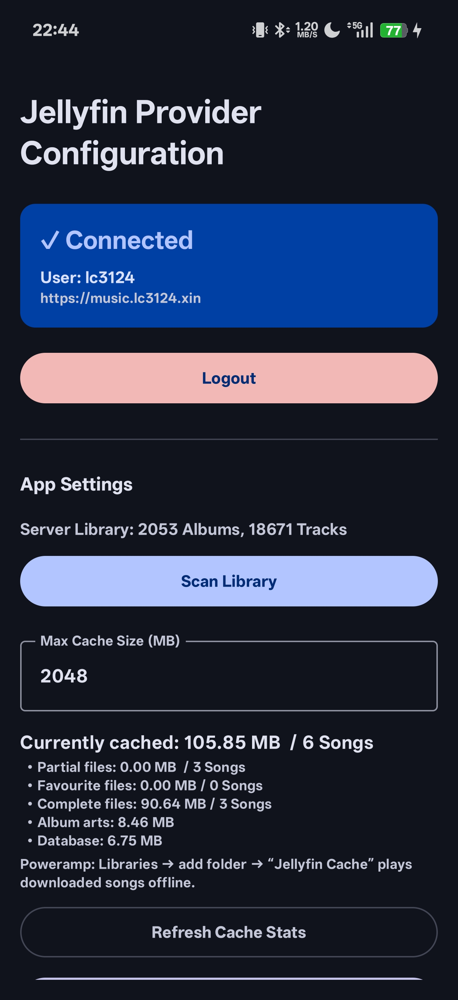
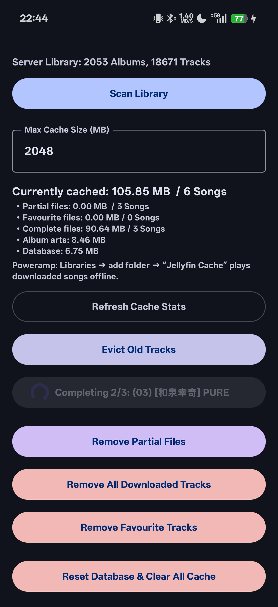
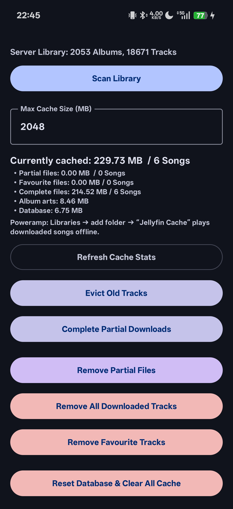
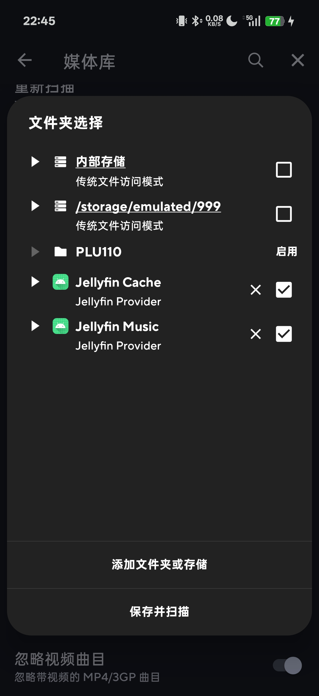

<p align="center"></p>

<h1 align="center">Jellyfin Provider for Poweramp</h1>

<p align="center"><b>English</b> | <a href="README.md">中文</a></p>

> ### Unofficial fork — read this first
>
> This is a personal fork of
> [ishanjain28/jellyfin-saf-provider](https://github.com/ishanjain28/jellyfin-saf-provider).
> **The original author has not reviewed, authorised, or endorsed this fork.** All credit for the
> original design and implementation belongs to them. Upstream ships no licence file, so this fork
> claims no additional rights: it exists strictly for technical study and personal experimentation.
>
> It is **not** published anywhere except this GitHub repository — no Play Store, no mirrors, no
> paid or bundled builds. Please do not redistribute it elsewhere or use it commercially.
>
> APKs are signed with the **default Android debug key**, not with a maintainer release key. They
> are provided as-is, without warranty and without any security review. Check the SHA-256 yourself
> and install at your own risk.

Expose your [Jellyfin](https://jellyfin.org) music library over Android's **Storage Access
Framework (SAF)**, so players that understand folders but not Jellyfin can still browse and
play your server music. Built and tuned for [Poweramp](https://powerampapp.com/), but any SAF
client should work.

Two roots are published:

| Root | What it does |
| --- | --- |
| **Jellyfin Music** | The full server library. Tracks are streamed on demand and cached in the background (HTTP Range + 256 KiB chunk bitmap), so seeking works and repeat plays come from disk. |
| **Jellyfin Cache** | Offline library. Lists **only fully downloaded** tracks and serves them straight from disk — no network, no login, no fallback to streaming. |

## Screenshots

<table>
  <tr>
    <td align="center"><br/>Settings &amp; cache overview</td>
    <td align="center"><br/>Completing partial downloads</td>
  </tr>
  <tr>
    <td align="center"><br/>All cached tracks finished</td>
    <td align="center"><br/>Both roots picked in Poweramp</td>
  </tr>
</table>

## Features

- **Transparent streaming cache** — sparse file per track, downloaded in 256 KiB chunks with
  `Range` requests; a bitmap in Room records which chunks are on disk, so playback can start
  immediately, seek anywhere and resume after a restart.
- **Offline root with real metadata** — tags, album artist, year, track/disc number, genre,
  favourite flag, lyrics (LRC, including synced lyrics) and album art are all served from the
  local database. This fork exposes them in `Jellyfin Cache` too, so an offline library looks
  exactly like a tagged local one to Poweramp.
- **Complete Partial Downloads** — one button walks every half-downloaded track and fetches only
  the missing byte ranges. Progress survives failures; run it again to continue.
- **Automatic LRU eviction** — once the cache limit is exceeded, least-recently-used tracks are
  removed, never one that is currently being played. Manual control is still available.
- **Album art prefetch** — when a track finishes downloading, its album cover is cached so the
  offline root has artwork.
- **Encrypted credentials** — password and access token are encrypted with an AES/GCM key in the
  Android Keystore; only metadata is kept in `SharedPreferences`.
- Poweramp-specific columns (`lyrics`, `lyrics_synced`, `com.maxmpz.poweramp.provider.COLUMN_FLAGS`)
  and the `com.maxmpz.PowerampTrackProvider` declaration, so tags/artwork/lyrics arrive through the
  cursor instead of being parsed from files.

## How it works

```
Poweramp ── SAF (content://) ──> JellyfinMusicProvider (DocumentsProvider)
                                      │
                    ┌─────────────────┼──────────────────┐
                    ▼                 ▼                  ▼
          JellyfinClientManager  TrackPlaybackManager   Room
          (Jellyfin SDK+OkHttp)  (streams & cache)      (metadata, chunk bitset, lyrics)
                    │                 │
                    ▼                 ▼
              Jellyfin server   files/jellyfin_tracks/*.cache
```

- **Self-describing document ids** — `trk;album;track;size;duration` (online) and
  `ctrk;album;track;size;duration` (offline). SAF calls like `getSize()` are synchronous, so
  encoding size and duration in the id avoids extra database or network round-trips.
- **Proxy file descriptors** — instead of downloading a whole track before handing it to the
  player, `openDocument()` returns a `ProxyFileDescriptor` backed by four handler threads; the
  player reads, the provider fetches missing chunks and blocks the read until data arrives.
- **Fully cached tracks bypass the proxy** and return a plain `ParcelFileDescriptor`, so playback
  costs nothing extra.

## Download

Releases are published **only** in this repository's
[releases page](https://github.com/lc-3124/jellyfin-saf-provider/releases). Each APK targets
`arm64-v8a` and `x86_64`, is minified with R8 and signed with the Android debug key — see the
disclaimer above. Release notes and the file hash are included with every release.

## Build

Requirements: JDK 21, Android SDK platform `android-36.1` + build-tools `36.0.0` or newer.

```bash
# one-time: point Gradle at your SDK
echo "sdk.dir=$HOME/Android/Sdk" > local.properties

./gradlew assembleDebug      # app/build/outputs/apk/debug/app-debug.apk
./gradlew assembleRelease    # minified, signed with the debug key
```

The release workflow in `.github/workflows/release.yml` builds an APK on every `v*` tag.

## Usage

1. Install the APK and open **Jellyfin Provider**.
2. Enter the server URL (scheme optional), username and password, then **Save and Login**. The
   library is scanned automatically; **Scan Library** refreshes it later.
3. In Poweramp: *Settings → Libraries → Folders/Libraries → Add folder* and tick either or both of
   **Jellyfin Music** and **Jellyfin Cache**.
4. Play something. The current track is streamed and cached; once it is complete it also becomes
   visible in `Jellyfin Cache`.
5. To prepare an offline library, press **Complete Partial Downloads** — it finishes everything you
   started listening to but did not play to the end.

## Cache management

| Button | Effect |
| --- | --- |
| Refresh Cache Stats | Recomputes the size breakdown |
| Evict Old Tracks | Manual LRU eviction down to 90 % of the limit |
| Complete Partial Downloads | Fetches only the missing byte ranges of partial tracks |
| Remove Partial Files | Deletes half-downloaded tracks (favourites can be kept) |
| Remove All Downloaded Tracks | Deletes all cached audio |
| Remove Favourite Tracks | Deletes cached favourites only |
| Reset Database & Clear All Cache | Wipes metadata, states, audio and artwork |

## Known issues

1. Playback pauses when both this app and the player are in the background — Android battery
   optimisation suspends the provider. Set the provider's battery usage to **Unrestricted**. The
   app intentionally uses no wake locks or background jobs.
2. Very first browse of a large library has to fetch the album list from the server; it is cached
   for two minutes afterwards. If the server is slow, the picker can take a moment to populate.
3. Album art is only available offline after it has been fetched once while online (or after the
   track completed, thanks to the prefetch).

## Changes in this fork

Compared to upstream `v0.0.9`:

- Second SAF root `Jellyfin Cache` with full offline metadata (tags, lyrics, artwork).
- `Complete Partial Downloads` button.
- Fixed the cache index being wiped: metadata used `INSERT OR REPLACE`, whose implicit `DELETE`
  triggered the `ON DELETE CASCADE` on `track_state`, leaving orphaned `.cache` files. Metadata is
  now written with `@Upsert`; existing orphaned files are recovered on startup using their real
  allocated block count.
- Fixed eviction not being LRU (no ordering, no access time); now sorted by cache file mtime and
  skips tracks being read.
- Fixed eviction deleting metadata and firing its completion callback twice.
- Fixed the cache database size always reporting 0 (wrong database file name).
- Fixed rows silently disappearing when the caller requested a narrower column projection.
- Fixed a reader-count race when several consumers opened the same track.
- Fixed the plaintext password being kept after logout.
- The album listing is cached for two minutes to reduce binder-thread stalls.

## 中文速览

> **声明**：本仓库是 [ishanjain28/jellyfin-saf-provider](https://github.com/ishanjain28/jellyfin-saf-provider)
> 的个人 fork。**原作者并未审阅、授权或背书本项目**，原始设计与实现的所有功劳归原作者；上游未附
> 许可证文件，本 fork 不主张任何额外权利，仅用于技术学习与个人测试。
>
> 本项目**只在 GitHub 本仓库发布**，不上架任何应用商店，不在其他站点、网盘或任何付费渠道分发，
> 也请勿用于商业用途。
>
> 发布的 APK 使用 **Android 默认 debug 证书**签名，并非维护者正式发布证书，未经任何安全审计。
> 请自行核对 SHA-256，安装与使用风险自负。


把 Jellyfin 音乐库通过 Android SAF 暴露成文件夹，给只认本地文件的播放器（主要针对 Poweramp）用。

- **Jellyfin Music**：在线库，边播边下、支持随意拖动进度。
- **Jellyfin Cache**：只列已完整下载的歌，断网也能播，标签/封面/歌词齐全。
- **Complete Partial Downloads**：把听到一半的歌补下完整，只下缺失的分片。
- 缓存超限会自动按“最久未使用”淘汰，正在播放的不会删。
- 建议在系统设置里把本应用的电池优化设为“不限制”，否则后台播放可能被暂停。
