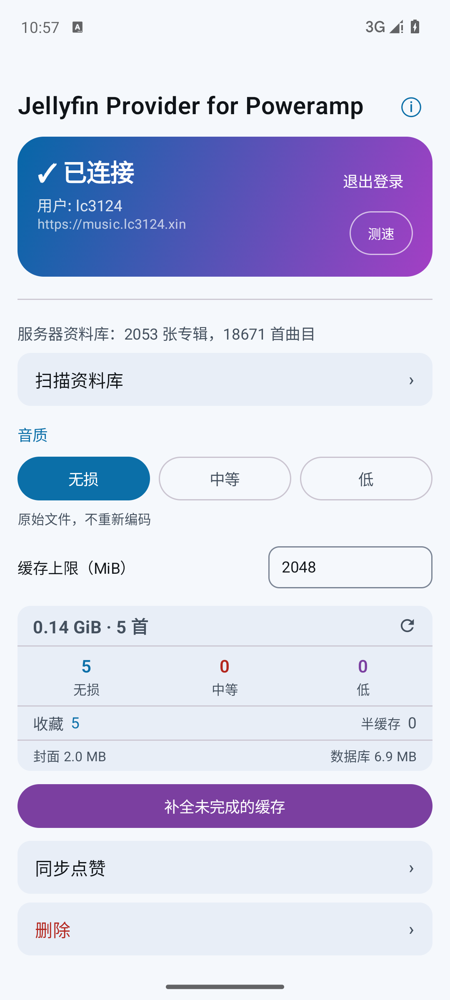
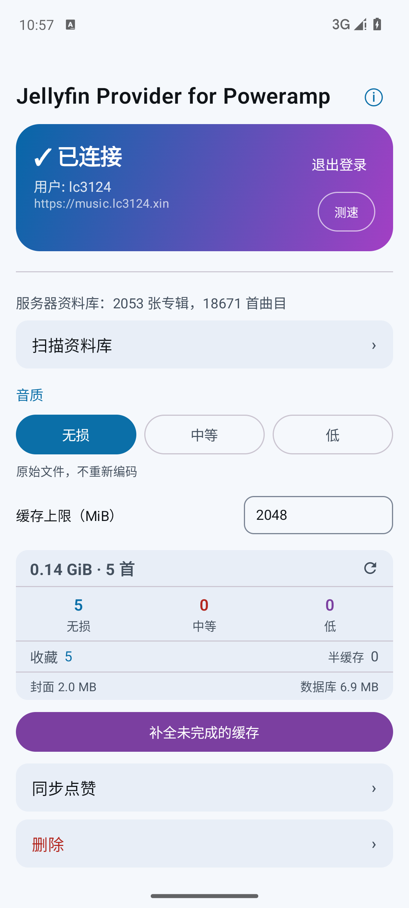
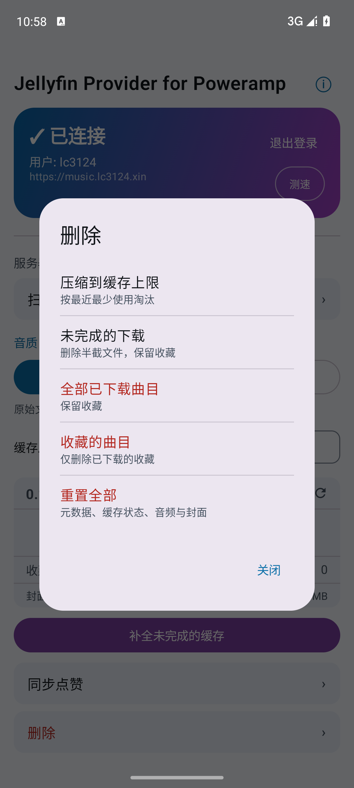
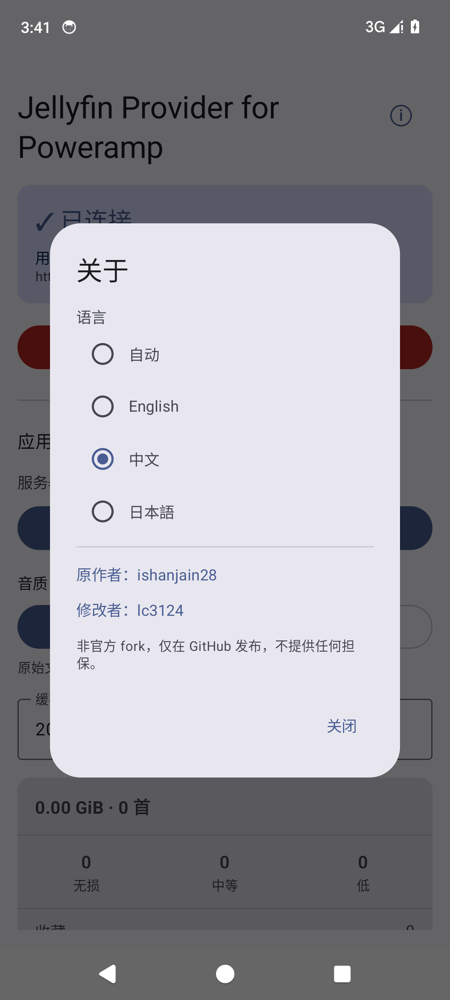

# Jellyfin Provider for Poweramp

[English](README.en.md) | **中文**

把 [Jellyfin](https://jellyfin.org) 音乐库通过 Android 的 **Storage Access Framework（SAF）**
暴露成文件夹，让只认本地文件的播放器（主要针对 [Poweramp](https://powerampapp.com/)）也能浏览、
播放、离线缓存你的服务器音乐。

仓库提供两个入口：

| 入口 | 用途 |
| --- | --- |
| **Jellyfin Music** | 在线库。按需流式播放，边下边缓存，可随意拖动进度。 |
| **Jellyfin Cache** | 离线库。只列出已完整下载的曲目，断网也能播，标签、封面、歌词齐全。 |

## 声明

> 本项目是 [ishanjain28/jellyfin-saf-provider](https://github.com/ishanjain28/jellyfin-saf-provider)
> 的个人 fork。**原作者并未审阅、授权或背书本项目**，原始设计与实现的所有功劳归原作者；上游未附
> 许可证文件，本 fork 不主张任何额外权利，仅用于技术学习与个人测试。
>
> 本项目**只在 GitHub 本仓库发布**，不上架任何应用商店，不在其他站点、网盘或任何付费渠道分发，
> 也请勿用于商业用途。
>
> 发布的 APK 使用 **Android 默认 debug 证书**签名，并非维护者正式发布证书，未经任何安全审计。
> 请自行核对 SHA-256，安装与使用风险自负。

## 截图

<table>
  <tr>
    <td align="center"><br/>连接状态与音质选择</td>
    <td align="center"><br/>缓存统计表格</td>
  </tr>
  <tr>
    <td align="center"><br/>弹窗式的删除菜单</td>
    <td align="center"><br/>语言切换与署名</td>
  </tr>
</table>

## 功能

- **两种 SAF 根目录**：在线库支持边下边播；离线库只暴露已下完整、纯本地读取的曲目。
- **三档音质**：无损 / 中等（AAC 128k）/ 低（AAC 64k）。可以在线转码播放，也可以只用于离线下载。
- **收藏双向同步**（依赖 Poweramp 的 content provider）：“同步点赞”点开弹窗，分两个方向：
  - **拉取**：把 Jellyfin 的收藏**增量**写入 Poweramp（只增不减、不下载）；
  - **推送**：先弹确认框列出将新增/取消的数量，确认后才把 Poweramp 的喜欢**镜像**回 Jellyfin，
    并下载收藏曲目。
  - 扫描资料库不再自动同步收藏。
- **完整的元数据**：标题、艺术家、专辑艺术家、年份、音轨/碟号、流派、收藏标记、歌词（含 LRC
  时间轴）、封面，全部通过 SAF 游标提供给播放器，离线库同样可用。
- **扫描与增量同步**：首次全量 4 路并发按专辑抓取、批量写库；之后只同步服务器上近期有变更的曲目
  （通常几秒），数量对不上会自动退回全量并清掉已删除的曲目。
- **缓存管理**：自动按最近最少使用淘汰、补全未完成的下载、按档位统计；点按缓存卡片即可刷新，
  删除操作收进弹窗。
- **已连接卡片**：退出登录、测速（访问 `/System/Info/Public`，结果用气泡提示往返毫秒）都在卡片右侧。
- **缓存统计卡片**：点按即刷新，右上角有刷新图标；收藏和半缓存并排显示。
- **多语言与配色**：自动跟随系统语言，右上角 ⓘ 可手动切换 English / 中文 / 日本語；另有四套配色
  （暗色蓝紫红、暗色绿黄橙、亮色蓝紫红、亮色绿黄橙），用一排拼色图标选择，不占文字空间。
- **凭据安全**：密码与 access token 使用 Android Keystore 中的 AES/GCM 密钥加密后保存。

## 工作原理

```
Poweramp ── SAF (content://) ──> JellyfinMusicProvider (DocumentsProvider)
                                      │
                    ┌─────────────────┼──────────────────┐
                    ▼                 ▼                  ▼
          JellyfinClientManager  TrackPlaybackManager   Room
          (Jellyfin SDK + OkHttp) (流式与缓存)           (元数据、分块位图、歌词)
                    │                 │
                    ▼                 ▼
              Jellyfin 服务器    files/jellyfin_tracks/*.cache
```

- **自描述文档 id**：`trk;专辑;曲目;大小;时长`（在线）与 `ctrk;...`（离线）。SAF 的 `getSize()`
  是同步调用，把大小和时长编码进 id 可以省掉额外的数据库或网络往返。
- **无损档**：每首歌一个稀疏文件，按 256 KiB 分块下载，用 Room 里的位图记录哪些块已落盘，读请求
  缺块时阻塞等待，播放器可以边下边播、任意拖动。
- **转码档**：通过 ProxyFileDescriptor 边转边播，下载完成后原子替换为缓存文件；文件长度用
  码率 × 时长估算。
- **完整缓存命中**：直接返回真实文件描述符，零网络、零代理开销。

## 安装与使用

1. 从本仓库的 [Releases](https://github.com/lc-3124/jellyfin-saf-provider/releases) 下载 APK 安装；
2. 打开应用，填写服务器地址、用户名、密码，登录后会自动扫描资料库；
3. 在 Poweramp 中：*设置 → 资料库 → 文件夹/资料库 → 添加文件夹*，勾选 **Jellyfin Music**
   或 **Jellyfin Cache**；
4. 播放歌曲即可，边听边缓存；已完整的曲目会出现在离线库中。

## 音质分级

| 档位 | 播放方式 | 缓存文件 |
| --- | --- | --- |
| 无损 | 原文件直出（`static=true`） | `<id>.cache` |
| 中等 | AAC 128 kbps 转码 | `<id>.aac128.cache` |
| 低 | AAC 64 kbps 转码 | `<id>.aac64.cache` |

- 每首歌只保留一份缓存，**优先保留更高质量**；降档不会删除已有高质量缓存。
- 播放时若缓存档位 ≥ 当前设置，直接播缓存；否则按当前档位重新转码/下载。
- 转码请求会带唯一的 `playSessionId`，避免服务器复用旧任务导致码率不生效。

## 收藏同步

“同步点赞”点开弹窗，两个方向都要手动触发；**扫描资料库不会再自动拉取**。

**拉取（Jellyfin → Poweramp）**

- 拉取远端全部收藏，逐首把 Poweramp 里 `rating == 0` 的写成 5；
- 增量：已在 `poweramp_pushed.json` 中记录过、之后被你在 Poweramp 里取消的曲目不会强行加回；
- 只增不减、不下载、不覆盖已有的 1–5 评分。

**推送（Poweramp → Jellyfin，执行前确认）**

- 点击后先计算差异并弹确认框：将新增 X 首、取消 Y 首；没有变化时只提示“已经一致”；
- 确认后，Poweramp 里 `rating` 为 1–5 的曲目全部设为 Jellyfin 收藏；
- Jellyfin 已收藏、但 Poweramp 未喜欢且 Poweramp 曲库中存在的曲目，取消收藏；
- 完成后按当前音质下载收藏曲目。

> 写入 Poweramp 使用的是它**未公开**的 content provider（`com.maxmpz.audioplayer.data/files`），
> 已在 Poweramp build 1035 上验证可读写；未来版本可能变化，应用会逐条校验并在失败时停止。

## 扫描与增量同步

“扫描资料库”点开弹窗，两个子项：

**全量扫描**

- 按专辑抓取曲目，4 路并发（这台服务器 `/Items` 约 3–6 请求/秒，4 路已够）；
- 每张专辑一次批量写入，不再一首一个事务；超过 100 首的合集会翻页；
- 完成后删掉服务器上已经不存在的曲目，并记录同步游标；
- 实测 2,053 张专辑 / 18,670 首约 **83 秒**。
- 服务器上极少数没有专辑归属（`albumId=null`）的曲目按专辑扫不到，会有 1–2 首的缺口，
  在 `ORPHAN_TOLERANCE` 容忍范围内，不影响增量判断。

**增量扫描**

- 用 Jellyfin 的 `MinDateLastSaved` 只取上次同步之后有变更的曲目，实测 **1 秒以内**；
- 游标用服务器本地时间、回退 30 分钟，重复写入是幂等的；
- 增量看不到“删除”，结束时会比对本地与服务器曲目数，本地反而更多就自动退回全量。

> 登录后的首次同步用 AUTO 模式：库为空或数量对不上跑全量，否则跑增量。
> 从旧版本升级上来、本地已经是完整库时，只补游标，不强制重扫。

## 缓存管理

- **刷新缓存统计**：点按缓存统计卡片即可重新计算（不再单独放按钮）；
- **补全未完成的缓存**：只补缺失的分块，失败保留进度；
- **删除（弹窗）**：压缩到上限、未完成的下载、全部已下载、收藏曲目、重置全部（二次确认）。

## 构建

需要 JDK 21、Android SDK `android-36.1` 与 build-tools 36：

```bash
echo "sdk.dir=$HOME/Android/Sdk" > local.properties
./gradlew assembleDebug      # app/build/outputs/apk/debug/app-debug.apk
./gradlew assembleRelease    # 开启 R8，使用 debug 证书签名
```

## 已知问题

1. 后台播放可能被系统暂停：请把本应用的电池优化设为“不限制”。
2. 转码档首次播放需要等待服务器启动 ffmpeg（约 1 秒），随后边下边播；波形图在整首下载完后出现。
3. 收藏同步的“取消”只作用于 Poweramp 已经扫描到的曲目，未扫描的远端收藏会被保留。
4. 缓存淘汰、删除、统计都以“真正播放过”的曲目为准，预取不会写入磁盘。

## 语言

默认跟随系统语言（中文 / 日本語 / 其他为英文），也可以在右上角 ⓘ 中手动指定并持久保存。
